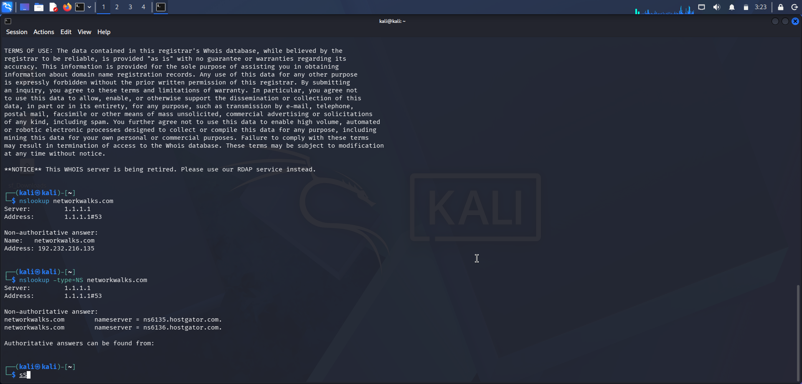
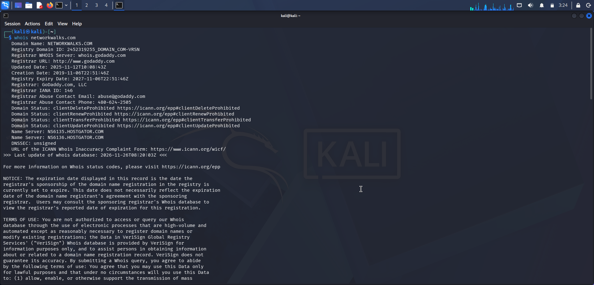
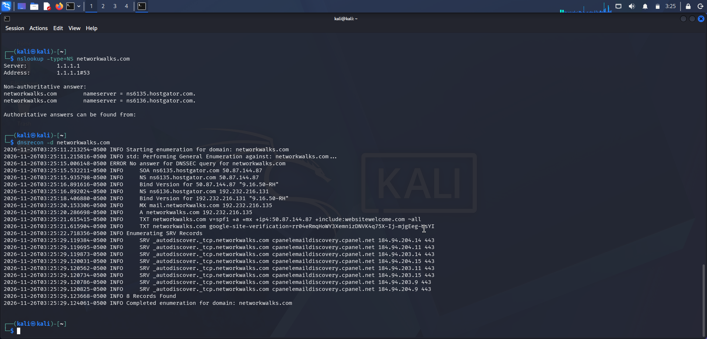
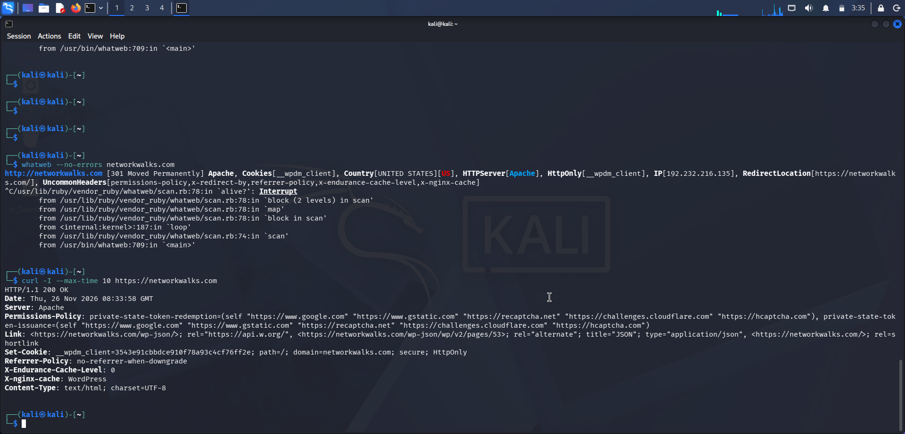
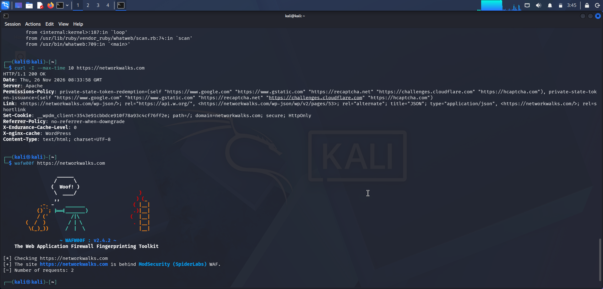
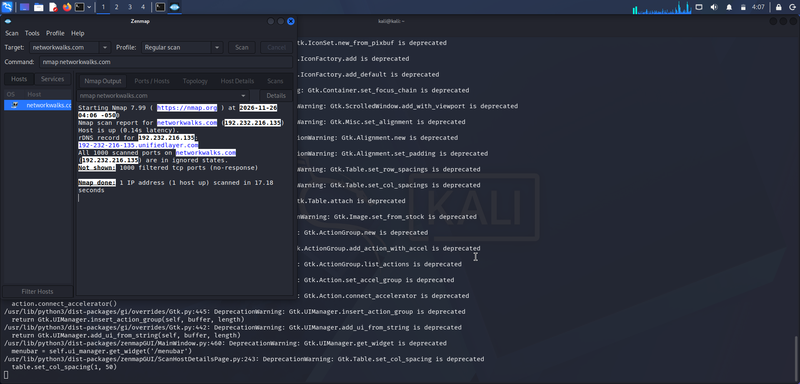

# Week 2 – Cybersecurity Network Reconnaissance & Scanning

## Project Overview

This project focuses on performing authorized reconnaissance and network scanning using Kali Linux.

### Modules Completed

- **W2-PM1:** Footprinting with Multiple Kali Tools
- **W2-PM5:** Zenmap-Based Network Scanning
- **W2-PM-FINAL:** Detailed Report

---

# W2-PM1 – Footprinting with Multiple Kali Tools

## Objective

The objective of this module is to collect publicly available information about the authorized target `networkwalks.com` using multiple Kali Linux reconnaissance and fingerprinting tools.

The tools used were:

- WHOIS
- nslookup
- DNSRecon
- WhatWeb
- cURL
- WAFW00F

---

## 1. WHOIS

### Purpose

WHOIS is used to obtain domain registration and registrar information.

### Command

```bash
whois networkwalks.com
```

### Key Observations

- Registrar: GoDaddy.com, LLC
- Domain creation date: 2019-11-06
- Registry expiry date: 2027-11-06
- Nameservers were identified.
- Registrant information was privacy protected.

### Evidence


---

## 2. nslookup

### Purpose

`nslookup` is used to query DNS records and identify information such as IP addresses and nameservers.

### Commands

```bash
nslookup networkwalks.com
```

```bash
nslookup -type=NS networkwalks.com
```

### Key Observations

- `networkwalks.com` resolved to:

```text
192.232.216.135
```

- Nameservers identified:

```text
ns6136.hostgator.com
ns6135.hostgator.com
```

### Evidence


---

## 3. DNSRecon

### Purpose

DNSRecon is used to enumerate DNS records associated with a domain.

### Command

```bash
dnsrecon -d networkwalks.com
```

### Key Observations

The scan identified several DNS record types, including:

- A record
- NS records
- SOA record
- MX record
- TXT records
- SRV record

The target IP identified was:

```text
192.232.216.135
```

### Evidence


---

## 4. WhatWeb and cURL

### WhatWeb Purpose

WhatWeb is used for web technology fingerprinting.

### Command

```bash
whatweb --no-errors networkwalks.com
```

### Observations

WhatWeb identified:

- Apache web server
- IP address `192.232.216.135`
- HTTP 301 redirect to HTTPS
- `__wpdm_client` cookie
- Additional HTTP headers

### cURL Purpose

cURL was used to inspect the HTTPS response headers.

### Command

```bash
curl -I --max-time 10 https://networkwalks.com
```

### Observations

The HTTPS endpoint returned:

```text
HTTP/1.1 200 OK
Server: Apache
Content-Type: text/html; charset=UTF-8
```

The response headers also contained WordPress-related REST API links.

### Evidence


> **Note:** WhatWeb and cURL are intentionally shown together in one screenshot.

---

## 5. WAFW00F

### Purpose

WAFW00F is used to identify Web Application Firewalls protecting a web application.

### Command

```bash
wafw00f https://networkwalks.com
```

### Result

The tool identified:

```text
ModSecurity (SpiderLabs) WAF
```

The scan used 2 requests.

### Evidence


---

# W2-PM5 – Zenmap-Based Network Scanning

## Objective

The objective of this module is to perform basic network scanning against the authorized target using Zenmap/Nmap.

### Target

```text
networkwalks.com
```

### Resolved IP

```text
192.232.216.135
```

### Scan Profile

```text
Regular scan
```

### Key Results

- Host was detected as **up**.
- Approximate latency: **0.16 seconds**
- 1 IP address was scanned.
- 1000 default TCP ports were scanned.
- The scanned ports were reported as **filtered/no-response**.
- Reverse DNS identified:

```text
192-232-216-135.reverse.hostgator.com
```

### Evidence


---

# Findings and Observations

| Module | Tool | Main Observation |
|---|---|---|
| W2-PM1 | WHOIS | Domain registration and nameserver information identified |
| W2-PM1 | nslookup | Target resolved to `192.232.216.135` |
| W2-PM1 | DNSRecon | Multiple DNS record types identified |
| W2-PM1 | WhatWeb | Apache and web technologies identified |
| W2-PM1 | cURL | HTTPS response headers inspected |
| W2-PM1 | WAFW00F | ModSecurity (SpiderLabs) WAF detected |
| W2-PM5 | Zenmap | Host up; 1000 TCP ports reported as filtered/no-response |

---

# Security Observations

The reconnaissance activities identified information about the target's domain, DNS configuration, web technologies, HTTP headers, WAF protection, and network exposure.

The presence of Apache, WordPress-related headers, DNS records, or a WAF **does not by itself prove the existence of a security vulnerability**.

The Zenmap scan reported the scanned TCP ports as filtered/no-response, which means Nmap could not determine them as open or closed because responses were not received.

---

# Conclusion

The project successfully demonstrated basic cybersecurity reconnaissance and network scanning techniques using Kali Linux.

W2-PM1 provided experience with domain reconnaissance, DNS enumeration, web technology fingerprinting, HTTP header inspection, and WAF identification.

W2-PM5 demonstrated basic network scanning using Zenmap/Nmap and showed how filtered ports can affect scan results.

All observations in this report are based on the commands and results obtained during the project.

---

# Tools Used

- Kali Linux
- WHOIS
- nslookup
- DNSRecon
- WhatWeb
- cURL
- WAFW00F
- Zenmap
- Nmap

---

### Evidence

### Evidence



### Evidence



### Evidence

### Evidence

### Evidence

### Evidence



